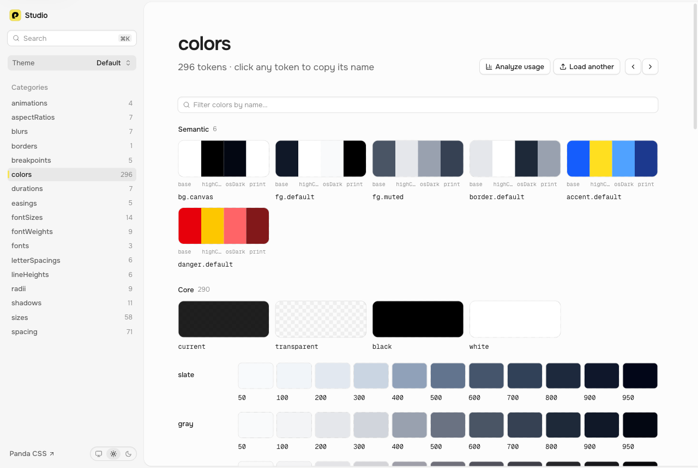

# Panda Studio

See your Panda design system in the browser. No install, no account, nothing uploaded.



## Use

Run `panda codegen --spec`, then open `styled-system/specs/design-system.json` in Studio: drop it, paste it, or load it
from an https URL. URL loads keep `#url=` in the address, so the page can be shared.

- **⌘K** searches the whole spec: tokens, values, references, recipes, patterns, conditions, themes.
- **Themes** narrow the view to the tokens they override.
- **Analyze usage** scans your source for used and unused tokens. Include `panda.config.ts` for compiler-grade results.

## Develop

Uses the published `@pandacss/*` packages; `@pandacss/compiler-wasm` needs a Rust toolchain that deploy builders lack.

```bash
pnpm --filter studio dev
pnpm --filter studio build
pnpm --filter studio sample  # regenerate public/sample-design-system.json from sample/panda.config.ts
```

## Deploy

Vercel project **panda-studio-v2**; pushing to `v2` deploys. `NUXT_PUBLIC_SITE_URL` sets the canonical origin.

```bash
pnpm --filter studio run deploy          # production
pnpm --filter studio run deploy:preview  # preview
```

Keep the `run`: `pnpm deploy` is a pnpm builtin.
